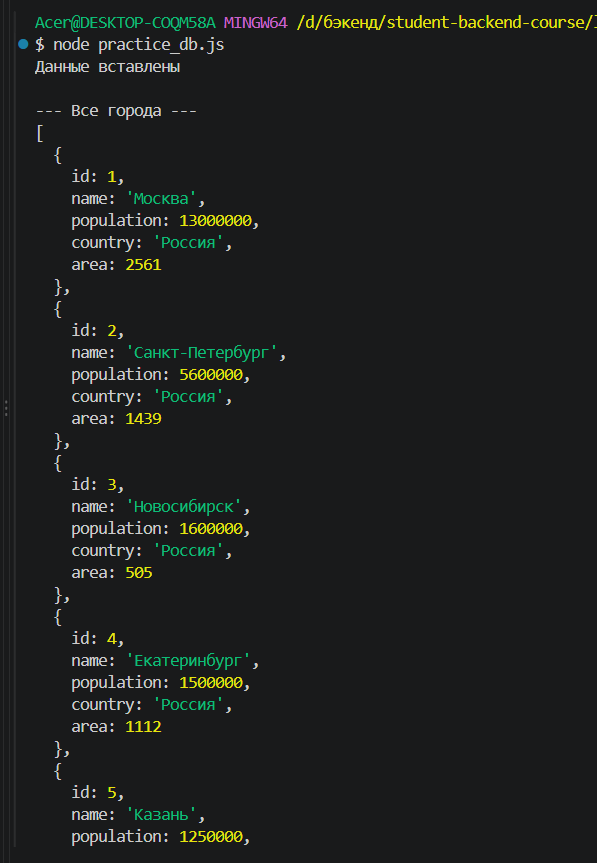
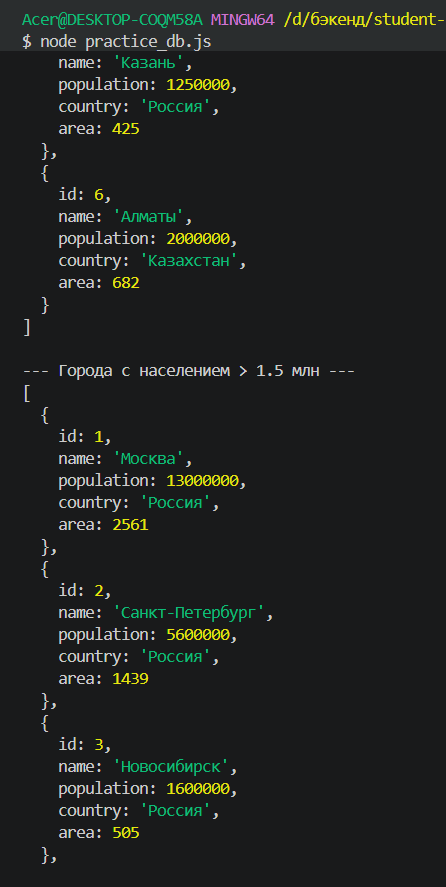
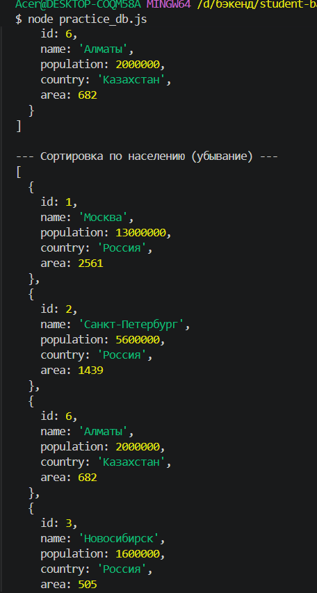
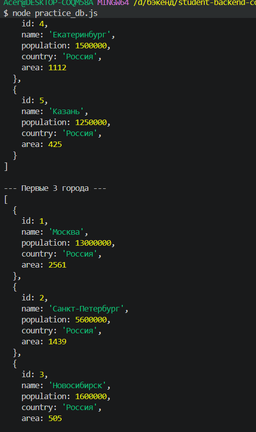
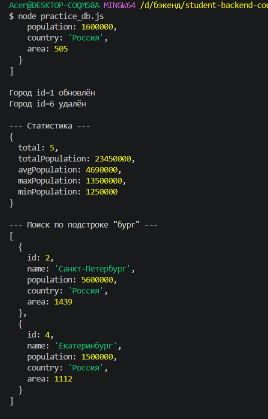
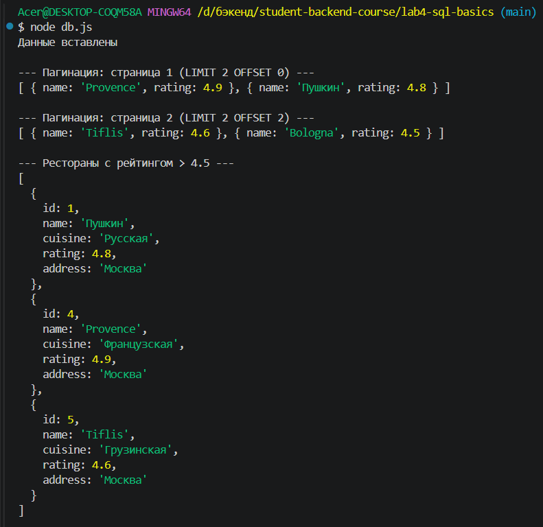
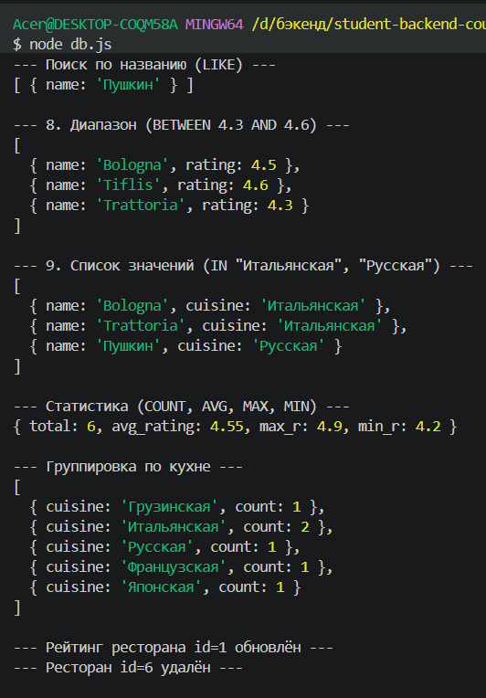
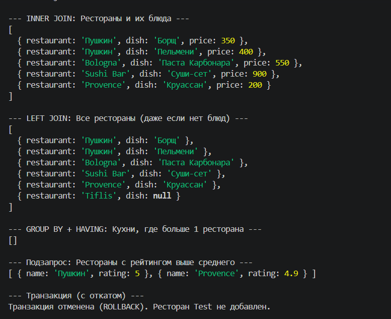

# Лабораторная работа №4: Основы SQL и работа с SQLite

**Студент:** Калмазова Серафима Владимировна  
**Группа:** ПИЖ-б-о-25-1  
**Вариант:** 14(продвинутый)
**СУБД:** SQLite (JS)
---

## Цель работы
Освоить базовые операции SQL. Научиться создавать таблицы, наполнять их данными, выполнять выборку, обновление и удаление записей. Понять разницу между SQL-запросами и работой с данными в памяти. Научиться использовать SQLite в качестве локальной СУБД для прототипирования и обучения.

## Теоретическое обоснование

**SQL (Structured Query Language)** — это декларативный язык структурированных запросов для работы с реляционными базами данных. Он позволяет создавать таблицы (DDL), манипулировать данными (DML), управлять доступом и транзакциями. Вы описываете, *что* хотите получить, а СУБД сама решает, *как* это сделать.

**SQLite** — это встроенная реляционная СУБД, которая хранит всю базу данных в одном файле (например, `lab4.db`). Она не требует отдельного сервера, идеально подходит для обучения, прототипирования и мобильных приложений. 

**Основные команды:** `CREATE TABLE` (создание таблиц), `INSERT` (вставка данных), `SELECT` (выборка), `WHERE` (фильтрация), `UPDATE` (обновление), `DELETE` (удаление), `ORDER BY` (сортировка), `LIMIT/OFFSET` (пагинация), агрегатные функции (`COUNT`, `SUM`, `AVG`), `JOIN` (объединение таблиц), `GROUP BY` (группировка) и транзакции (`BEGIN`, `COMMIT`, `ROLLBACK`).

---

## Выполнение практического примера

Для выполнения работы используется скрипт миграции `init_db.sql` и основной скрипт `db.js`. В качестве СУБД выбран SQLite.

### Код скрипта миграции (init_db.sql)
```sql
-- Таблица 1: Рестораны (основная)
CREATE TABLE IF NOT EXISTS restaurants (
    id INTEGER PRIMARY KEY AUTOINCREMENT,
    name TEXT NOT NULL,
    cuisine TEXT NOT NULL,
    rating REAL,
    address TEXT
);

-- Таблица 2: Блюда (связана с ресторанами)
CREATE TABLE IF NOT EXISTS dishes (
    id INTEGER PRIMARY KEY AUTOINCREMENT,
    restaurant_id INTEGER NOT NULL,
    name TEXT NOT NULL,
    price REAL NOT NULL,
    FOREIGN KEY (restaurant_id) REFERENCES restaurants(id) ON DELETE CASCADE
);

-- Индекс для ускорения поиска по кухне
CREATE INDEX IF NOT EXISTS idx_restaurants_cuisine ON restaurants(cuisine);
```

---

## Основной скрипт `practice_db.js` 

```js
// Подключаем библиотеку для работы с SQLite
const Database = require('better-sqlite3');
// Создаем или открываем файл базы данных
const db = new Database('lab4.db');

// ============ 1. СОЗДАНИЕ ТАБЛИЦЫ ============
db.exec(`
  CREATE TABLE IF NOT EXISTS cities (
    id INTEGER PRIMARY KEY AUTOINCREMENT, 
    name TEXT NOT NULL,
    population INTEGER,
    country TEXT DEFAULT 'Россия',
    area REAL
  )
`);
// AUTOINCREMENT - автоматически ставит id (1, 2, 3...)
// PRIMARY KEY - уникальный идентификатор строки

// Очищаем таблицу, если запускаем код повторно
db.exec('DELETE FROM cities');

// ============ 2. INSERT (ВСТАВКА) ============
// prepare() создает "шаблон" запроса, run() подставляет данные
const insert = db.prepare('INSERT INTO cities (name, population, country, area) VALUES (?, ?, ?, ?)');
insert.run('Москва', 13000000, 'Россия', 2561);
insert.run('Санкт-Петербург', 5600000, 'Россия', 1439);
insert.run('Новосибирск', 1600000, 'Россия', 505);
insert.run('Екатеринбург', 1500000, 'Россия', 1112);
insert.run('Казань', 1250000, 'Россия', 425);
insert.run('Алматы', 2000000, 'Казахстан', 682);
console.log('Данные вставлены');

// ============ 3. SELECT (ВЫБОРКА) ============
console.log('\n--- Все города ---');
// .all() выполняет запрос и возвращает массив объектов (все строки)
const all = db.prepare('SELECT * FROM cities').all();
console.log(all);

// ============ 4. WHERE (ФИЛЬТРАЦИЯ) ============
console.log('\n--- Города с населением > 1.5 млн ---');
// Знак ? заменяется на 1500000 (защита от SQL-инъекций)
const big = db.prepare('SELECT * FROM cities WHERE population > ?').all(1500000);
console.log(big);

// ============ 5. ORDER BY (СОРТИРОВКА) ============
console.log('\n--- Сортировка по населению (убывание) ---');
const sorted = db.prepare('SELECT * FROM cities ORDER BY population DESC').all();
console.log(sorted);

// ============ 6. LIMIT (ОГРАНИЧЕНИЕ) ============
console.log('\n--- Первые 3 города ---');
const limited = db.prepare('SELECT * FROM cities LIMIT 3').all();
console.log(limited);

// ============ 7. UPDATE (ОБНОВЛЕНИЕ) ============
db.prepare('UPDATE cities SET population = ? WHERE id = ?').run(13500000, 1);
console.log('\nГород id=1 обновлён');

// ============ 8. DELETE (УДАЛЕНИЕ) ============
db.prepare('DELETE FROM cities WHERE id = ?').run(6);
console.log('Город id=6 удалён');

// ============ 9. АГРЕГАЦИЯ ============
console.log('\n--- Статистика ---');
// .get() возвращает ровно один объект (одну строку с результатами)
const stats = db.prepare(`
  SELECT
    COUNT(*) as total,
    SUM(population) as totalPopulation,
    AVG(population) as avgPopulation,
    MAX(population) as maxPopulation,
    MIN(population) as minPopulation
  FROM cities
`).get();
console.log(stats);

// ============ 10. LIKE (ПОИСК) ============
console.log('\n--- Поиск по подстроке "бург" ---');
const search = db.prepare('SELECT * FROM cities WHERE name LIKE ?').all('%бург%');
console.log(search);

// Закрываем базу
db.close();
```

**Команды для запуска**
npm init -y
npm install better-sqlite3
node practice_db.js

## Скриншоты вывода практического примера



**рисунок 1** 



**рисунок 2 (продолжение)** 



**рисунок 3 (продолжение)** 



**рисунок 4 (продолжение)** 



**рисунок 5 (продолжение)** 
---

## Выполнение индивидуального задания

**Вариант 14: Рестораны (restaurants)**
Таблицы: restaurants (id, name, cuisine, rating, address) и dishes (id, restaurant_id, name, price).

Базовый уровень:
1. Создать БД SQLite с одной таблицей для своей сущности.
2. Выполнить INSERT - минимум 5 записей.
3. Выполнить SELECT * - все записи.
4. Выполнить SELECT с WHERE - фильтрация по одному полю.
5. Выполнить UPDATE - обновить одну запись.
6. Выполнить DELETE - удалить одну запись.

Средний уровень:
1. SELECT с сортировкой (ORDER BY) - по возрастанию и
убыванию.
2. SELECT с LIMIT и OFFSET - пагинация (2 страницы).
3. SELECT с LIKE - поиск по подстроке.
4. SELECT с BETWEEN - диапазон.
5. SELECT с IN - список значений.
6. SELECT с агрегатными функциями (COUNT, AVG, MAX, MIN,
SUM).
7. SELECT с GROUP BY - группировка (например, по стране).

Продвинутый уровень (max 60 баллов)
Требования: всё из среднего + дополнительные функции:
1. Вторая таблица со связью FOREIGN KEY (один-ко-многим).
2. JOIN - выборка с объединением двух таблиц (INNER JOIN).
3. LEFT JOIN - выборка с сохранением всех строк из первой
таблицы.
4. GROUP BY + HAVING - группировка с фильтром.
5. Подзапрос (SELECT внутри SELECT).
6. Транзакция - BEGIN, COMMIT, ROLLBACK.
7. Индекс - создать INDEX для ускорения поиска.
8. Скрипт миграции - отдельный файл init_db.sql.
9. Приложить скриншоты всех запросов.

## Скрипт миграции (init_db.sql):

```sql
-- Удаляем старые таблицы, если они были
DROP TABLE IF EXISTS dishes;
DROP TABLE IF EXISTS restaurants;

-- Создаем таблицу ресторанов
CREATE TABLE restaurants (
    id INTEGER PRIMARY KEY AUTOINCREMENT,
    name TEXT NOT NULL,
    cuisine TEXT NOT NULL,
    rating REAL,
    address TEXT
);

-- Создаем таблицу блюд (связана с ресторанами)
CREATE TABLE dishes (
    id INTEGER PRIMARY KEY AUTOINCREMENT,
    restaurant_id INTEGER NOT NULL,
    name TEXT NOT NULL,
    price REAL NOT NULL,
    FOREIGN KEY (restaurant_id) REFERENCES restaurants(id) ON DELETE CASCADE
);

-- Индекс для быстрого поиска по кухне
CREATE INDEX idx_restaurants_cuisine ON restaurants(cuisine);
```

## Основной скрипт `db.js` 

```js
const fs = require('fs'); 
const Database = require('better-sqlite3');
const db = new Database('lab4.db');


// Включаем поддержку внешних ключей (FOREIGN KEY) в SQLite
db.pragma('foreign_keys = ON');

// ============ 1. ВЫПОЛНЕНИЕ SQL-СКРИПТА ============
// Читаем файл init_db.sql и выполняем всё, что там написано
const sqlScript = fs.readFileSync('init_db.sql', 'utf8');
db.exec(sqlScript);

// ============ 2. INSERT (ВСТАВКА) ============
const insertRest = db.prepare('INSERT INTO restaurants (name, cuisine, rating, address) VALUES (?, ?, ?, ?)');
insertRest.run('Пушкин', 'Русская', 4.8, 'Москва');
insertRest.run('Bologna', 'Итальянская', 4.5, 'Москва');
insertRest.run('Sushi Bar', 'Японская', 4.2, 'СПб');
insertRest.run('Provence', 'Французская', 4.9, 'Москва');
insertRest.run('Tiflis', 'Грузинская', 4.6, 'Москва');
insertRest.run('Trattoria', 'Итальянская', 4.3, 'СПб');

const insertDish = db.prepare('INSERT INTO dishes (restaurant_id, name, price) VALUES (?, ?, ?)');
insertDish.run(1, 'Борщ', 350);
insertDish.run(1, 'Пельмени', 400);
insertDish.run(2, 'Паста Карбонара', 550);
insertDish.run(3, 'Суши-сет', 900);
insertDish.run(4, 'Круассан', 200);
console.log('Данные вставлены');

// ============ 3. SELECT + ORDER BY + LIMIT (Сортировка и Пагинация) ============
console.log('\n--- Пагинация: страница 1 (LIMIT 2 OFFSET 0) ---');
console.log(db.prepare('SELECT name, rating FROM restaurants ORDER BY rating DESC LIMIT 2 OFFSET 0').all());

console.log('\n--- Пагинация: страница 2 (LIMIT 2 OFFSET 2) ---');
console.log(db.prepare('SELECT name, rating FROM restaurants ORDER BY rating DESC LIMIT 2 OFFSET 2').all());

// ============ 4. WHERE + LIKE (Поиск) ============
console.log('\n--- Рестораны с рейтингом > 4.5 ---');
console.log(db.prepare('SELECT * FROM restaurants WHERE rating > ?').all(4.5));

console.log('\n--- Поиск по названию (LIKE) ---');
console.log(db.prepare("SELECT name FROM restaurants WHERE name LIKE ?").all('%Пуш%'));

// 4.1. BETWEEN (Средний уровень) - ДОБАВЛЕНО
console.log('\n--- 8. Диапазон (BETWEEN 4.3 AND 4.6) ---');
console.log(db.prepare('SELECT name, rating FROM restaurants WHERE rating BETWEEN ? AND ?').all(4.3, 4.6));

// 4.2. IN (Средний уровень) - ДОБАВЛЕНО
console.log('\n--- 9. Список значений (IN "Итальянская", "Русская") ---');
console.log(db.prepare("SELECT name, cuisine FROM restaurants WHERE cuisine IN (?, ?)").all('Итальянская', 'Русская'));

// ============ 5. АГРЕГАЦИЯ и GROUP BY ============
console.log('\n--- Статистика (COUNT, AVG, MAX, MIN) ---');
console.log(db.prepare('SELECT COUNT(*) as total, AVG(rating) as avg_rating, MAX(rating) as max_r, MIN(rating) as min_r FROM restaurants').get());

console.log('\n--- Группировка по кухне ---');
console.log(db.prepare('SELECT cuisine, COUNT(*) as count FROM restaurants GROUP BY cuisine').all());

// ============ 6. UPDATE и DELETE ============
db.prepare('UPDATE restaurants SET rating = ? WHERE id = ?').run(5.0, 1);
console.log('\n--- Рейтинг ресторана id=1 обновлён ---');

db.prepare('DELETE FROM restaurants WHERE id = ?').run(6);
console.log('--- Ресторан id=6 удалён ---');

// ============ 7. INNER JOIN (Объединение) ============
console.log('\n--- INNER JOIN: Рестораны и их блюда ---');
const innerJoin = db.prepare(`
  SELECT r.name AS restaurant, d.name AS dish, d.price
  FROM restaurants r
  INNER JOIN dishes d ON r.id = d.restaurant_id
`).all();
console.log(innerJoin);

// ============ 8. LEFT JOIN ============
console.log('\n--- LEFT JOIN: Все рестораны (даже если нет блюд) ---');
const leftJoin = db.prepare(`
  SELECT r.name AS restaurant, d.name AS dish
  FROM restaurants r
  LEFT JOIN dishes d ON r.id = d.restaurant_id
`).all();
console.log(leftJoin);

// ============ 9. GROUP BY + HAVING ============
console.log('\n--- GROUP BY + HAVING: Кухни, где больше 1 ресторана ---');
const having = db.prepare(`
  SELECT cuisine, COUNT(*) as count
  FROM restaurants
  GROUP BY cuisine
  HAVING count > 1
`).all();
console.log(having);

// ============ 10. ПОДЗАПРОС (SELECT внутри SELECT) ============
console.log('\n--- Подзапрос: Рестораны с рейтингом выше среднего ---');
const subquery = db.prepare(`
  SELECT name, rating FROM restaurants
  WHERE rating > (SELECT AVG(rating) FROM restaurants)
`).all();
console.log(subquery);

// ============ 11. ТРАНЗАКЦИЯ (BEGIN, ROLLBACK) ============
console.log('\n--- Транзакция (с откатом) ---');
try {
  // db.transaction создает безопасную обертку
  const transaction = db.transaction(() => {
    insertRest.run('Test', 'Test', 5.0, 'Тест');
    // Если тут выбросить ошибку (throw new Error), изменения откатятся
    throw new Error('Отмена тестовой транзакции'); 
  });
  transaction();
} catch (e) {
  console.log('Транзакция отменена (ROLLBACK). Ресторан Test не добавлен.');
}

db.close();
```

## Скриншоты вывода 



**рисунок 1**




**рисунок 2 (продолжение)** 




**рисунок 3 (продолжение)** 


---

## Контрольные вопросы

**1. Что такое SQL и зачем он нужен?**
SQL (Structured Query Language) — декларативный язык для работы с реляционными базами данных. Позволяет создавать таблицы, вставлять, обновлять, удалять и выбирать данные. Используется для управления структурированной информацией в СУБД (SQLite, PostgreSQL, MySQL и др.).

**2. Что такое SQLite и чем отличается от PostgreSQL?**
SQLite — встроенная (embedded) СУБД, хранящая всю базу в одном файле. Не требует сервера. PostgreSQL — клиент-серверная СУБД для высоконагруженных систем. SQLite идеальна для обучения и прототипов, PostgreSQL — для продакшена.

**3. Как создать таблицу?**
```sql
CREATE TABLE restaurants (
    id INTEGER PRIMARY KEY AUTOINCREMENT,
    name TEXT NOT NULL,
    rating REAL
);
```

**4. Что такое PRIMARY KEY и AUTOINCREMENT?**
`PRIMARY KEY` — уникальный идентификатор строки (не может быть NULL или дублироваться). `AUTOINCREMENT` — автоматическое увеличение значения при каждой новой вставке.

**5. Как вставить данные?**
```sql
INSERT INTO restaurants (name, cuisine, rating) VALUES ('Пушкин', 'Русская', 4.8);
```

**6. Как выбрать все данные из таблицы?**
```sql
SELECT * FROM restaurants;
```

**7. Что такое WHERE?**
Условие фильтрации. Например: `SELECT * FROM restaurants WHERE rating > 4.5;` — выбирает только рестораны с рейтингом выше 4.5.

**8. Что делает UPDATE?**
Обновляет существующие записи. Например: `UPDATE restaurants SET rating = 5.0 WHERE id = 1;` — меняет рейтинг ресторана с id=1.

**9. Что делает DELETE?**
Удаляет записи. Например: `DELETE FROM restaurants WHERE id = 6;` — удаляет ресторан с id=6.

**10. Что такое AUTOINCREMENT?**
Атрибут, который автоматически присваивает уникальное целое число каждому новому ряду (1, 2, 3...).

**11. Что делает ORDER BY?**
Сортирует результат. `ORDER BY name ASC` — по возрастанию, `ORDER BY rating DESC` — по убыванию.

**12. Что такое LIMIT и OFFSET?**
`LIMIT` — ограничивает количество строк. `OFFSET` — пропускает указанное количество строк (для пагинации). `SELECT * FROM restaurants LIMIT 2 OFFSET 2` — берет 2 строки, начиная с третьей.

**13. Что такое LIKE?**
Поиск по шаблону. `%` — любое количество символов, `_` — один символ. Например: `WHERE name LIKE '%бург%'` найдёт «Санкт-Петербург».

**14. Что такое BETWEEN?**
Выбор данных в диапазоне (включительно): `WHERE rating BETWEEN 4.3 AND 4.6`.

**15. Что такое IN?**
Выбор данных из списка: `WHERE cuisine IN ('Итальянская', 'Русская')`.

**16. Какие агрегатные функции вы знаете?**
`COUNT(*)` — количество строк, `SUM(population)` — сумма, `AVG(rating)` — среднее, `MAX()`/`MIN()` — максимум/минимум.

**17. Что такое GROUP BY?**
Группировка строк по одному или нескольким полям для применения агрегатных функций. Например: `SELECT cuisine, COUNT(*) FROM restaurants GROUP BY cuisine`.

**18. Чем отличается WHERE от HAVING?**
`WHERE` фильтрует строки **до** группировки. `HAVING` — фильтрует **сгруппированные** данные (после `GROUP BY`).

**19. Как реализовать пагинацию через SQL?**
Через `LIMIT` и `OFFSET`: `LIMIT 10 OFFSET 0` — страница 1, `LIMIT 10 OFFSET 10` — страница 2.

**20. Как избежать SQL-инъекций? Что такое параметризованные запросы?**
Использовать **параметризованные запросы** — передавать значения через `?` (в Python) или `$1` (в PostgreSQL). Например: `cursor.execute("SELECT * FROM users WHERE name = ?", (user_input,))`. Это защищает от внедрения SQL-кода.

**21. Что такое FOREIGN KEY? Зачем нужен?**
Внешний ключ — связь между двумя таблицами (один-ко-многим). Например: `dishes.restaurant_id REFERENCES restaurants(id)`. Запрещает вставлять блюдо к несуществующему ресторану.

**22. Что такое JOIN? Какие виды бывают?**
Объединение строк из двух таблиц по общему полю. Виды: `INNER JOIN` (только совпадения), `LEFT JOIN` (все из первой + совпадения из второй), `RIGHT JOIN` (все из второй + совпадения из первой), `FULL JOIN` (все из обеих).

**23. Чем отличается INNER JOIN от LEFT JOIN?**
`INNER JOIN` возвращает только строки, где есть совпадения в обеих таблицах. `LEFT JOIN` — все строки из первой таблицы плюс совпадения из второй (если их нет — `NULL`).

**24. Что такое подзапрос? Приведите пример.**
Запрос внутри другого запроса. Пример: `SELECT name FROM restaurants WHERE rating > (SELECT AVG(rating) FROM restaurants);` — выбирает рестораны с рейтингом выше среднего.

**25. Что такое транзакция? Что делают BEGIN, COMMIT, ROLLBACK?**
Транзакция — атомарная группа операций. `BEGIN` — начать, `COMMIT` — подтвердить изменения, `ROLLBACK` — отменить всё, вернуться к состоянию до начала транзакции.

**26. Что такое индекс? Зачем нужен? Как создать?**
Индекс ускоряет поиск по столбцу. Создаётся командой: `CREATE INDEX idx_name ON restaurants(name);`. Используется для столбцов, по которым часто ищут (WHERE, JOIN).

**27. Как организовать миграции БД?**
Хранить SQL-скрипты (например, `init_db.sql`) и применять их при первом запуске. Для сложных проектов используют инструменты: Alembic, Flyway, Liquibase.

**28. Что такое нормализация? Какие нормальные формы вы знаете?**
Нормализация — процесс устранения избыточности в БД. 1НФ (атомарность), 2НФ (зависимость от полного ключа), 3НФ (устранение транзитивных зависимостей).

**29. Как оптимизировать SQL-запросы?**
Использовать индексы, избегать `SELECT *` (выбирать только нужные поля), ограничивать `LIMIT`, использовать `EXPLAIN` для анализа плана выполнения.

**30. Что такое EXPLAIN?**
Команда, показывающая план выполнения запроса (какие индексы используются, сколько строк просканировано). Помогает найти узкие места.

---

## Вывод
В ходе работы я освоила базовые и продвинутые операции SQL на примере СУБД SQLite, научилась создавать таблицы, настраивать связи через FOREIGN KEY, выполнять вставку, выборку, обновление и удаление данных. Также разобралась с пагинацией (LIMIT/OFFSET), поиском (LIKE), агрегатными функциями (COUNT, AVG), группировкой (GROUP BY/HAVING) и объединением таблиц (INNER/LEFT JOIN).

## Список использованных источников

* SQLite — официальный сайт: https://www.sqlite.org/
* Документация Python по модулю sqlite3: https://docs.python.org/3/library/sqlite3.html
* Интерактивный курс по SQL (SQLBolt): https://sqlbolt.com/
* MDN Web Docs: SQL (Glossary): https://developer.mozilla.org/ru/docs/Glossary/SQL

